# Gestão de eventos e palestrantes

Aplicação web para organizar eventos, manter um cadastro profissional de palestrantes e conectar agendamento, histórico e divulgação.

O projeto integra **Node.js, JavaScript, Power Automate, SharePoint, Outlook/Teams e WordPress**. As chamadas aos serviços externos passam pelo servidor, mantendo credenciais e endereços assinados dos fluxos fora do navegador.

> Todas as telas abaixo utilizam identidade visual e dados demonstrativos. As capturas do Power Automate não incluem os cabeçalhos que identificam o ambiente e a conta corporativa.

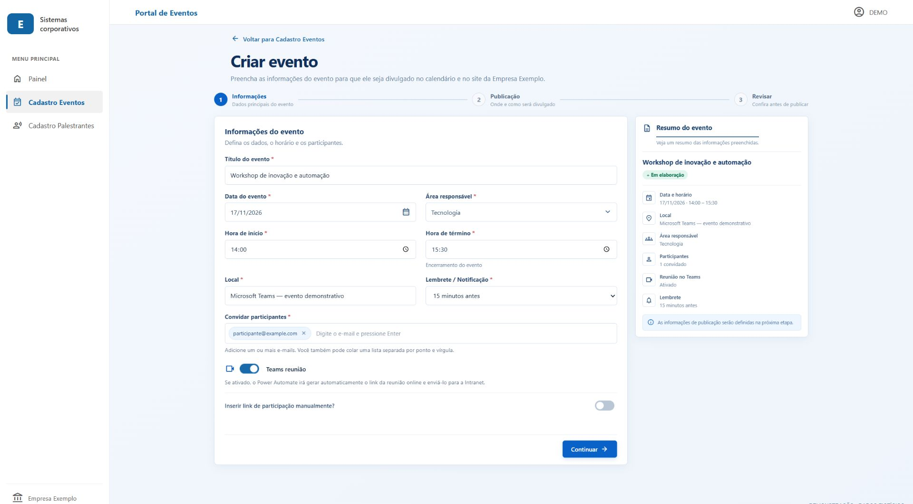

## Funcionalidades

- Cadastro de eventos em etapas: informações, descrições e revisão.
- Agendamento no Outlook/Teams por meio do Power Automate.
- Publicação opcional da divulgação no WordPress.
- Cadastro e histórico de palestrantes, com seus eventos relacionados.
- Histórico de eventos e gerenciamento conforme as regras do fluxo.
- Seleção de palestrantes no evento e cadastro rápido em formulário compartilhado.
- Modalidade, gratuidade e faixa de valor por participação.
- Origem do contato, área responsável e validação do cadastro.
- Página de auditoria com filtros, detalhes, paginação e exportação CSV.
- Integração de autenticação corporativa com Microsoft Entra ID e MSAL.

### Estado das novas integrações

| Recurso | Estado |
|---|---|
| Cadastros básicos e históricos | Integrações existentes preservadas |
| Palestrantes na criação do evento | Interface implementada; envio depende da adaptação do fluxo e da lista de participações |
| Origem e validação do palestrante | Interface e validações implementadas; persistência depende do mapeamento no Power Automate |
| Auditoria | Implementada no servidor, com armazenamento persistente configurável |
| Login corporativo | Implementação preparada e testes simulados; configuração HTTPS e validação no tenant real pendentes |

Os novos envios permanecem bloqueados até a habilitação das capacidades correspondentes. O [guia de integração](INTEGRATION-UPGRADE.md) descreve os contratos e a homologação necessária.

## Telas do sistema

### Revisão antes do envio

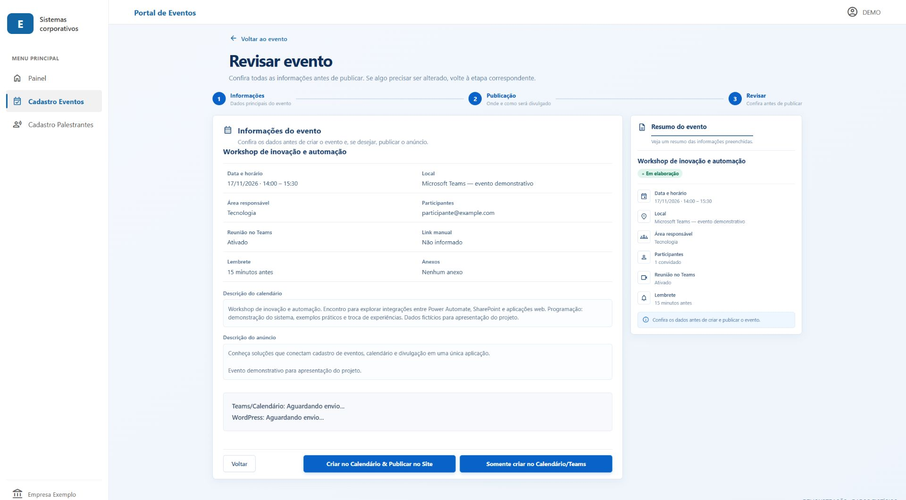

### Histórico de eventos

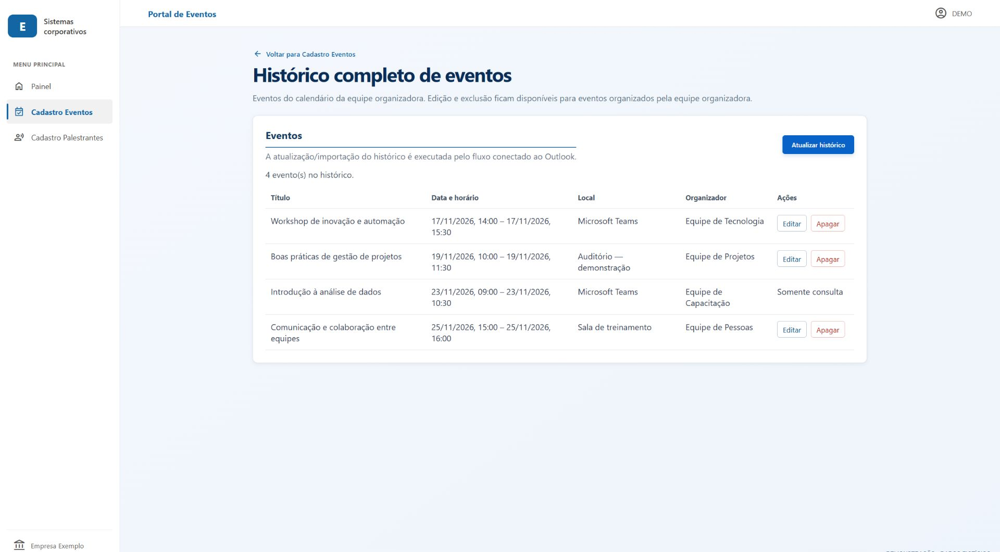

### Histórico de palestrantes e participações

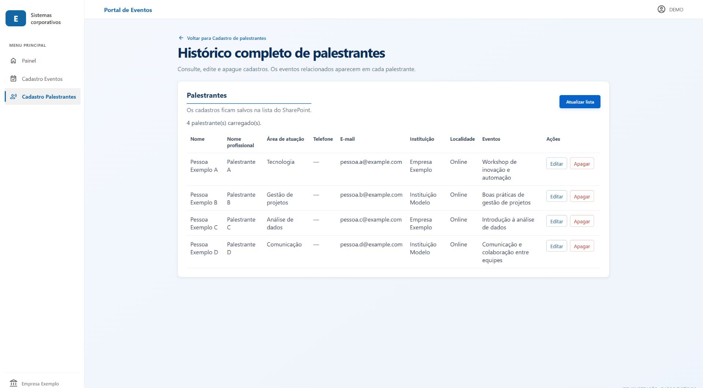

<details>
<summary>Ver outras telas demonstrativas</summary>

#### Painel inicial

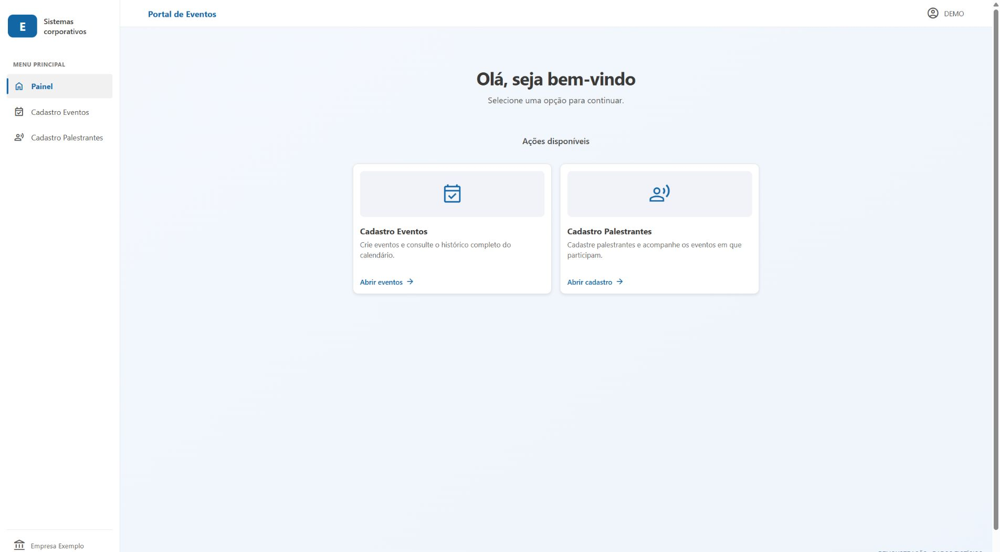

#### Descrições do calendário e da divulgação

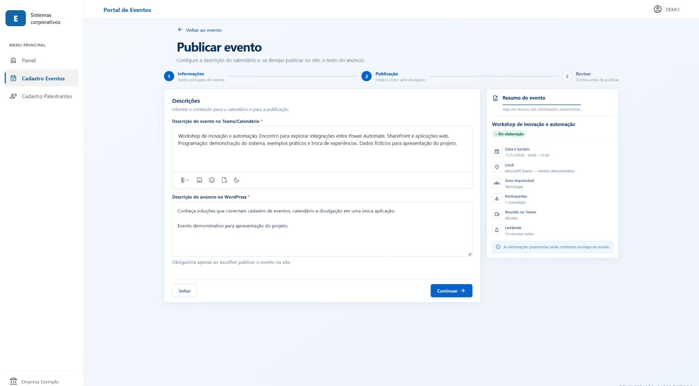

#### Cadastro de palestrante

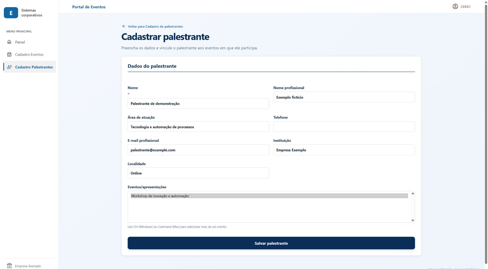

</details>

As capturas ilustram uma versão demonstrativa. Os novos campos e a página de auditoria evoluem conforme o estado descrito acima.

## Arquitetura

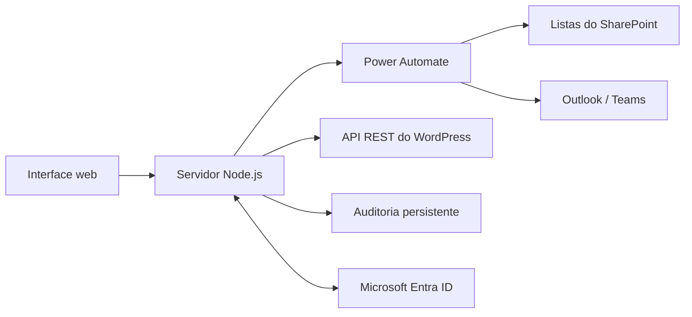

| Componente | Responsabilidade |
|---|---|
| HTML, CSS e JavaScript | Formulários, revisão, históricos e consulta de auditoria |
| Node.js | Validação, sessão, integração com os serviços e auditoria |
| Power Automate | Operações no Microsoft 365 e comunicação com as listas |
| SharePoint | Armazenamento de palestrantes, eventos e participações |
| Outlook/Teams | Calendário e reuniões online, conforme a configuração do fluxo |
| WordPress | Publicação opcional do anúncio do evento |
| Microsoft Entra ID | Identificação e autorização das contas corporativas |

O acesso ao SharePoint é realizado pelos fluxos do Power Automate. A aplicação não acessa as listas diretamente pelo navegador.

## Fluxos do Power Automate

### Criação no calendário e processamento de documentos

O fluxo recebe uma solicitação HTTP e contém etapas para armazenar documentos no SharePoint, compor a descrição, consultar horários e criar o evento no Outlook.

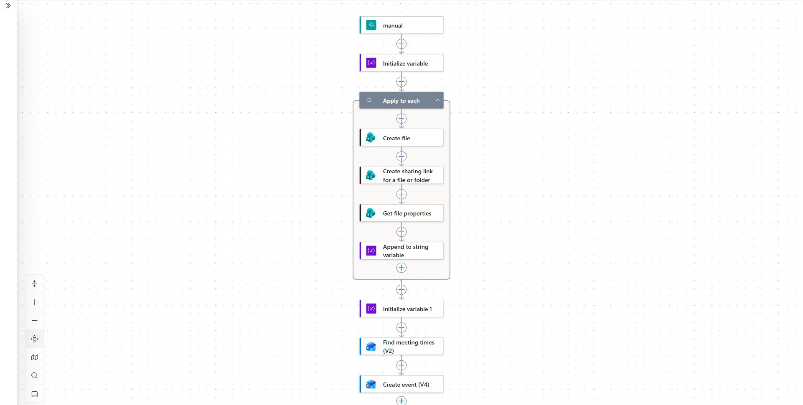

O processamento de documentos depende da configuração do fluxo. Mantenha `TEAMS_ATTACHMENTS_ENABLED=false` até validar essa integração.

### API de gestão

Um fluxo único pode encaminhar as operações pelos recursos `speakers`, `participations` e `events`. Também é possível configurar fluxos separados.

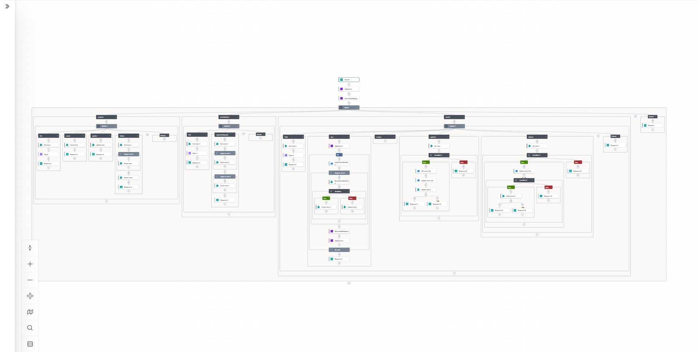

[Abrir diagrama em tamanho original](docs/images/05-api-gestao-completa.jpg)

### Sincronização do calendário

Fluxo complementar acionado por alterações no Outlook, com consultas e operações no SharePoint conforme suas condições.

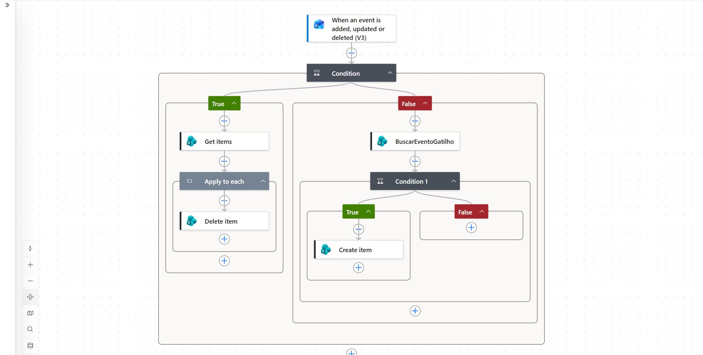

As imagens representam os fluxos existentes. Os ajustes para as novas condições de participação estão descritos no [guia de integração](INTEGRATION-UPGRADE.md).

## Modelo de dados

| Lista | Conteúdo |
|---|---|
| `Palestrantes` | Identificação profissional, contatos, instituição, localidade, origem e validação |
| `Eventos Palestrantes` | Dados do evento e referências do calendário |
| `Participacoes` | Relacionamento entre palestrante e evento, modalidade e condições de participação |

As condições comerciais e a modalidade pertencem à participação: a mesma pessoa pode atuar de maneiras diferentes em eventos distintos. O cadastro de palestrantes não solicita documentos pessoais, dados bancários ou avaliações subjetivas.

## Executar localmente

Requisitos: **Node.js 20.6 ou superior**, npm e acesso aos serviços externos para utilizar as integrações reais.

```powershell
git clone https://github.com/ericbeltraoo/refer-event-publisher.git
cd refer-event-publisher
npm ci
Copy-Item .env.example .env
```

Preencha o `.env` com as configurações do seu ambiente e execute:

```powershell
npm start
```

Abra [http://localhost:3000](http://localhost:3000).

No desenvolvimento, `AUTH_MODE=disabled` mostra que a sessão não está autenticada. Esse modo não identifica usuários corporativos e é rejeitado quando `NODE_ENV=production`.

## Configuração

Use [.env.example](.env.example) como referência. Nunca versione o `.env` real.

| Grupo | Variáveis |
|---|---|
| Calendário | `TEAMS_FLOW_URL`, `TEAMS_ATTACHMENTS_ENABLED` |
| Gestão por fluxo único | `MANAGEMENT_FLOW_URL` |
| Alternativa com fluxos separados | `SPEAKERS_FLOW_URL`, `PARTICIPATIONS_FLOW_URL`, `EVENTS_FLOW_URL` |
| WordPress | `WORDPRESS_URL`, `WORDPRESS_USERNAME`, `WORDPRESS_APP_PASSWORD` |
| Login Microsoft | `AUTH_MODE`, `ENTRA_TENANT_ID`, `ENTRA_CLIENT_ID`, `ENTRA_CLIENT_SECRET`, `ENTRA_REDIRECT_URI` |
| Autorização | `AUTH_EMAIL_DOMAIN`, `AUTH_ALLOWED_USERS`, `AUDIT_ADMIN_EMAILS` |
| Auditoria | `AUDIT_LOG_DIR`, `LOCAL_AUDIT_VIEW` |
| Novos contratos dos fluxos | `EVENT_SPEAKERS_ENABLED`, `SPEAKER_METADATA_ENABLED` |

As capacidades novas devem permanecer desativadas até a validação dos fluxos e das listas correspondentes. O segredo do aplicativo Microsoft fica somente no servidor.

## Docker e Portainer

Configure as variáveis da Stack e execute:

```sh
docker compose up -d --build
docker compose logs -f refer-event-publisher
```

O [Compose](compose.yaml) exige autenticação Microsoft Entra e uma URL de retorno HTTPS. Prepare o registro do aplicativo e o proxy antes de implantar essa configuração.

A porta 3000 é publicada no loopback do host para um proxy HTTPS no mesmo host. Para um proxy em outro container, configure uma rede Docker compartilhada e encaminhe para `refer-event-publisher:3000`.

O volume `refer-audit` preserva a auditoria entre recriações do container. Não o remova durante atualizações. As sessões ficam em memória nesta etapa: reinícios exigem novo login, e a aplicação deve operar com uma única réplica até adotar sessões compartilhadas.

## Auditoria e acesso

A página `#/logs` permite consultar todo o histórico disponível com filtros, páginas de 25, 50 ou 100 registros, detalhes na tabela e exportação da consulta completa em CSV.

Cada operação registrada contém data e hora, identidade autenticada quando disponível, categoria, ação, ID do registro, campos envolvidos, resultado e identificador de correlação. Início e resultado são entradas distintas da mesma operação.

Os logs não armazenam senhas, tokens, URLs assinadas, anexos ou valores dos dados de contato. A trilha cobre solicitações que passam pelo servidor; alterações diretas nos serviços externos precisam de sua própria auditoria. Não há recuperação automática de operações anteriores à ativação dos logs.

Em produção, telas e APIs exigem sessão válida. A TI deve configurar as atribuições da aplicação no Entra para os usuários ou grupos internos autorizados, incluindo a restrição de convidados. Consulta e exportação de auditoria são restritas às contas configuradas.

## Testes

```sh
npm test
```

A suíte cobre autenticação simulada, proteção de rotas, validação de identidade, origem das solicitações, cadastros, resultados parciais das integrações, paginação e exportação da auditoria. O login no ambiente Microsoft real e os contratos dos fluxos devem ser homologados separadamente.

## Estrutura e documentação

| Caminho | Conteúdo |
|---|---|
| `public/` | Interface, estilos e scripts |
| `test/` | Testes automatizados |
| `docs/images/` | Capturas demonstrativas |
| `server.js` | Servidor e integrações |
| `auth.js` | Sessão e Microsoft Entra |
| `audit.js` | Armazenamento e consulta de auditoria |
| `events-watcher.js` | Avisos de atualização do histórico |
| `Dockerfile` / `compose.yaml` | Imagem e implantação |

- [Contratos e roteiro de ativação](INTEGRATION-UPGRADE.md)
- [Referência dos fluxos existentes](docs/configuracao-fluxos.md)
- [Exemplo de configuração](.env.example)
